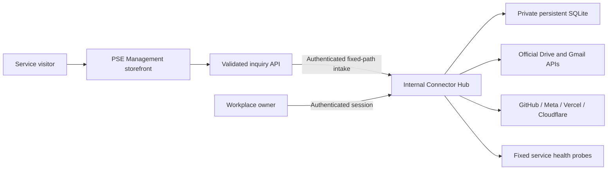

# OrgSuite workplace ecosystem

Updated October 18, 2026. This repository is the source of truth for OrgSuite and
PSE Management workplace code, operating instructions, and reviewable changes.
An inventory entry is not a current health check or a grant of account access.

## Components and ownership

| Component | Repository surface | Role and current boundary |
| --- | --- | --- |
| OrgSuite core | Root README, `docs/`, existing command-center surfaces | Workplace navigation, architecture, and official connector guidance |
| PSE Management services | [`psemanagement-services/`](../psemanagement-services/README.md) | Public service/storefront UI and the Vercel inquiry API; production deployment remains separately verified |
| Connector Hub | [`orgsuite-connector-hub/`](../orgsuite-connector-hub/README.md) | Internal, single-owner application for tested provider status, scoped Drive operations, service probes, and audit events |
| Workplace Status | Hub `/status` | Authenticated health and connector view; shares the Hub's configuration and status freshness rules |
| Inquiry delivery | [`inquiry-contract.md`](inquiry-contract.md) | Public API validates and forwards to the Hub's authenticated, encrypted, durable intake before acknowledging acceptance |
| Cloud Storage reference | [`cloud-storage/`](../cloud-storage/README.md) | Historical static Google/Microsoft UI; the new Hub supplies operational Google Drive integration |
| Cloudflare dashboard | [`cloudflare-dashboard/`](../cloudflare-dashboard/README.md) | Existing dashboard surface; Hub probes selected Cloudflare zones with separately provisioned read access |
| Hosting and domain checks | [Canonical hosts](canonical-hosts.md), [GoDaddy notes](godaddy-secure-integration.md) | Existing Vercel/Cloudflare/domain inventory; reachability does not prove registrar ownership or authorized DNS access |
| Marketing data | [Ads readiness](ads-readiness.md), [historical marketing notes](marketing-connectors.md) | Hub supports Meta account/metrics reads after authorization; campaign creation, launch, and spend remain outside this implementation |

The public inquiry API and the Hub dashboard use different authentication.
Visitors never receive the ingestion credential, provider tokens, or access to
internal dashboard data. See the [security model](connector-hub-security.md).

## Existing hosting inventory

These addresses are already recorded in this repository. Their inclusion here
does not assert that they are reachable, current, or served by this branch.

| Existing surface | Recorded address |
| --- | --- |
| Primary OrgSuite domain | https://pse-sent.com |
| MCP gateway | https://mcp.pse-sent.com/api/mcp |
| Cloudflare dashboard | https://dash.pse-sent.com |
| Edge host | https://host.pse-sent.com |
| Workplace attach | https://workplace.pse-sent.com |
| Codex command center | https://orgsuite-codex-command-center.vercel.app |
| Unified command center | https://orgsuite-command-center.vercel.app |
| Public site | https://orgsuite-public.vercel.app |
| GoDaddy health project | https://orgsuite-godaddy-health.vercel.app |
| PSE Management storefront target | https://psemanagement.services/store |

[Canonical hosts](canonical-hosts.md) contains the wider recorded domain map.
The named Vercel projects `orgsuite-meta-ai-agent` and
`orgsuite-meta-developers` also appear in existing marketing documentation;
their existence in an inventory is not evidence of a functioning Meta account
connection. Hub Vercel API reads require explicit project IDs and host-side
authorization. The Hub does not deploy, change DNS, or register domains.

## Navigation and status interpretation

Start at the [repository README](../README.md), then use the
[Hub setup guide](../orgsuite-connector-hub/README.md) for operational work or
the [workplace index](workplace-index.md) for the broader repository map.
The Hub dashboard links its `/status` page; the status page returns to the Hub.
The static cloud-storage page remains a reference surface and does not acquire
API credentials when the Hub is configured.

Only a successful provider test with evidence younger than five minutes can
show **Connected** in the Hub. A configured environment variable, completed
OAuth redirect, past chat connector result, or successful public URL probe
cannot establish equivalent account access. Re-test to refresh evidence.

The September 2026 status tables elsewhere in this repository preserve session
history. Use their stated dates; do not copy their Connected labels into a new
session or into Hub runtime state. As of this implementation, no Hub production
deployment, new provider consent, live inquiry acceptance, or campaign launch is
claimed. Production inquiry behavior is explicitly
[unverified](inquiry-contract.md#current-production-verification).

## Extension path

New providers belong in the Hub connector registry and require explicit
capabilities, validated configuration, fixed official API origins, bounded
responses, a real provider test, and sanitized status/audit output. Add focused
provider tests and update this map and the security scope table. Chat connector
credentials are not a credential source for the deployed application.

Google Ads and additional marketing services can be added through the same
boundary after official API access is provisioned. The current Hub has no
Google Ads client or campaign-write path. Follow [ads readiness](ads-readiness.md)
before adding an external data source or seeking launch authorization.
